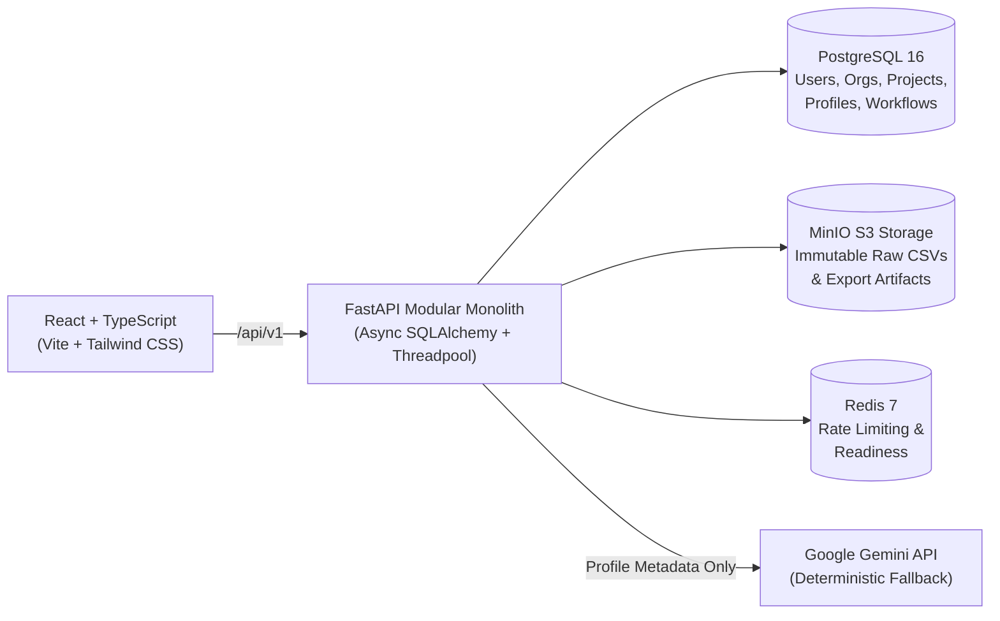

# AutoPrep AI

**AutoPrep AI** is a full-stack, multi-tenant dataset preparation SaaS platform that transforms raw CSV files into reproducible, leakage-free machine learning splits and fitted `scikit-learn` pipelines.

## Screenshots

| Page | Preview |
| :--- | :--- |
| **Login / Auth** |  |
| **Dashboard** |  |
| **Projects** |  |
| **Datasets** |  |
| **Data Quality Analysis** |  |
| **Workflows & Split** |  |
| **Reports & Exports** |  |
| **Team & Workspace** |  |

## Why AutoPrep AI?

Most ad-hoc data preparation scripts apply imputation, scaling, or encoding across the entire dataset *before* splitting—leaking test distribution statistics into training. AutoPrep AI enforces a strict **Split-Before-Fit** execution order:

1. **Stateless Row-Level Cleaning & Feature Engineering** (`drop_duplicates`, `cast_dtype`, `remove_outliers`, `extract_date_features`, `derive_ratio`, `drop_constant_columns`)
2. **Dataset Splitting First** (`stratified`, `random`, `time_based`, or `group_based`)
3. **Train-Only Pipeline Fitting** (`SimpleImputer`, `StandardScaler`/`MinMaxScaler`/`RobustScaler`, `OneHotEncoder`/`OrdinalEncoder` fitted exclusively on the training split, then applied to validation and test splits)
4. **Automated Validation & Leakage Checks** (verifies zero remaining NaNs and flags high-correlation or ID-like columns)

## System Architecture



## Key Features

### Multi-Tenant Auth & Workspaces
* JWT access tokens with **rotating refresh tokens** and server-side revocation (`POST /auth/logout`).
* Redis-backed rate limiting on authentication and password-reset endpoints.
* Personal and organization workspaces switched via the `X-Org-ID` header, with owner-controlled project and organization deletion.

### Immutable Dataset Management & Profiling
* Drag-and-drop CSV upload (up to 100 MB / 500,000 rows) stored immutably in MinIO with SHA-256 checksums and automatic semantic type inference (`numerical`, `categorical`, `datetime`, `boolean`, `text`).
* Paginated dataset preview table with column filtering and soft deletion.
* Automated **Data Quality Analysis** featuring missingness bars, numerical histograms, categorical top-value frequency charts, duplicate detection, and a color-coded correlation heatmap.

### Profile-Only Gemini AI Planner
* Sends **only** schema metadata and summary profile statistics (never raw rows) to `gemini-2.5-flash` to recommend an allowlisted preprocessing plan.
* Validates every AI-generated step strictly against a Pydantic allowlist (`AllowlistedStep`)—rejecting arbitrary code—and falls back cleanly to a deterministic rule-based planner when no API key is configured.

### Reproducible Exports
Every workflow execution produces versioned, downloadable artifacts in MinIO:
* `train.csv`, `val.csv`, `test.csv`
* `pipeline.joblib` (fitted `scikit-learn` `ColumnTransformer` + `Pipeline`)
* `workflow_config.json` & `validation_report.json`
* `project_bundle.zip` (all artifacts bundled together)

## Tech Stack

| Layer | Technologies |
| :--- | :--- |
| **Backend** | FastAPI, Python 3.11, SQLAlchemy (Async), Alembic, Pydantic v2, `pandas`, `scikit-learn`, `joblib`, `boto3` |
| **Frontend** | React 18, TypeScript, Vite, Tailwind CSS, Axios, Lucide Icons |
| **Data & Infra** | PostgreSQL 16, MinIO (S3-compatible), Redis 7, Docker Compose |
| **AI & Testing** | Google Gemini API (`gemini-2.5-flash`), `pytest`, `pytest-asyncio`, `ruff`, `mypy` |

## Quick Start (Docker Compose)

### 1. Configure Environment Variables

```bash
cp .env.example .env
```

*(Optional: add your `GEMINI_API_KEY` in `.env` to enable Gemini-powered workflow recommendations; otherwise, the built-in deterministic planner is used automatically.)*

### 2. Build and Start All Services

```bash
docker compose up --build
```

### 3. Access the Application

| Service | URL | Notes |
| :--- | :--- | :--- |
| **Frontend App** | http://localhost:5173 | React + TypeScript UI |
| **Swagger API Docs** | http://localhost:8000/docs | Interactive OpenAPI docs |
| **Readiness Check** | http://localhost:8000/api/v1/admin/ready | Verifies PostgreSQL & Redis |
| **MinIO Console** | http://localhost:9001 | Default: `minioadmin` / `minioadmin` |

## Environment Variables

| Variable | Default | Description |
| :--- | :--- | :--- |
| `APP_NAME` | `AutoPrep AI` | FastAPI application title |
| `ENVIRONMENT` | `development` | Runtime mode (`development` / `production`) |
| `DEBUG` | `true` | Enables SQL echo & dev password-reset token logging |
| `JWT_SECRET_KEY` | `change-me-in-production` | Secret key for signing JWT tokens |
| `DATABASE_URL` | `postgresql+asyncpg://autoprep:autoprep_dev_password@db:5432/autoprep_ai` | Async PostgreSQL URL |
| `MINIO_ENDPOINT` | `minio:9000` | MinIO S3 endpoint |
| `MINIO_ACCESS_KEY` | `minioadmin` | MinIO access key |
| `MINIO_SECRET_KEY` | `minioadmin` | MinIO secret key |
| `MINIO_BUCKET` | `autoprep-datasets` | Bucket for CSVs and workflow artifacts |
| `REDIS_URL` | `redis://redis:6379/0` | Redis URL for rate limiting & health checks |
| `MAX_UPLOAD_MB` | `100` | Maximum CSV file size (MB) |
| `MAX_ROW_COUNT` | `500000` | Maximum CSV row limit |
| `GEMINI_API_KEY` | *(empty)* | Optional Gemini API key |

## Database Migrations & Tests

```bash
# Apply Alembic migrations
docker compose exec api alembic upgrade head

# Run backend unit & security tests (tenant isolation, AI allowlist, no-leakage pipeline)
docker compose exec api pytest -q

# Type-check and build frontend
docker compose exec web npm run build
```

## API Endpoints (`/api/v1`)

&lt;details&gt;
&lt;summary&gt;Expand full endpoint reference&lt;/summary&gt;

* **Auth**: `POST /auth/register`, `POST /auth/login`, `POST /auth/refresh`, `POST /auth/logout`, `GET /auth/me`, `PATCH /auth/me`, `POST /auth/password-reset/request`, `POST /auth/password-reset/confirm`
* **Organizations**: `GET /orgs`, `POST /orgs`, `DELETE /orgs/{org_id}`, `POST /orgs/{org_id}/members`
* **Projects**: `GET /projects`, `POST /projects`, `GET /projects/{project_id}`, `DELETE /projects/{project_id}`
* **Datasets**: `POST /projects/{project_id}/datasets`, `GET /projects/{project_id}/datasets`, `GET /datasets/{dataset_id}`, `GET /datasets/{dataset_id}/preview`, `DELETE /datasets/{dataset_id}`
* **Profiling**: `POST /datasets/{dataset_id}/profile`, `GET /datasets/{dataset_id}/profile`
* **AI Planner**: `POST /projects/{project_id}/ai/recommend`, `POST /ai/recommendations/{rec_id}/approve`
* **Workflows & Exports**: `GET /projects/{project_id}/workflows`, `POST /projects/{project_id}/workflows`, `GET /workflows/{workflow_id}/executions`, `POST /workflows/{workflow_id}/execute`, `GET /executions/{execution_id}`, `GET /executions/{execution_id}/artifacts`, `GET /artifacts/{artifact_id}/download`
* **Admin**: `GET /admin/health`, `GET /admin/ready`

&lt;/details&gt;

## Project Structure

```text
autoprep-ai/
├── docker-compose.yml
├── .env.example
├── .gitignore
├── README.md
├── autoprep-ai_image/     # Application UI screenshots
├── backend/
│   ├── Dockerfile
│   ├── alembic.ini
│   ├── pyproject.toml
│   ├── app/
│   │   ├── main.py
│   │   ├── core/          # Config, async DB, Redis, security, MinIO storage
│   │   ├── migrations/    # Alembic env & initial schema migration
│   │   └── modules/       # auth, orgs, projects, datasets, profiling,
│   │                      # cleaning, transform, splitting, workflows, ai, exports, admin
│   └── tests/             # Security & ML pipeline unit tests
└── frontend/
    ├── Dockerfile
    ├── package.json
    ├── public/            # Static assets (login background)
    └── src/
        ├── api/           # Axios client with token refresh & X-Org-ID header
        ├── components/    # LayoutShell & reusable UI primitives
        ├── features/      # Auth, Dashboard, Projects, Datasets, Data Quality,
        │                  # Workflows, Reports & Exports, Team & Settings
        └── types/         # TypeScript API interfaces
```

## Author

**Sasi R**
* GitHub: [@Codeabc27](https://www.google.com/search?q=https://github.com/Codeabc27)
* LinkedIn: [linkedin.com/in/sasi-tech](https://www.google.com/search?q=https://www.linkedin.com/in/sasi-tech)